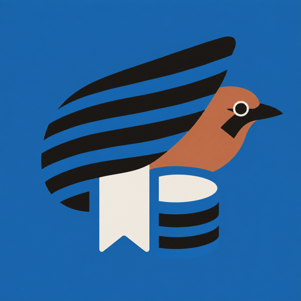

  

<h1 align="center">Kakesu</h1>

A bookmark app for tossing in pages you want to keep and digging them back out later. This is the public website for the iOS app Kakesu.

  <a href="https://fukuidinotech.github.io/kakesu-lp/">https://fukuidinotech.github.io/kakesu-lp/</a>

  <a href="https://fukuidinotech.github.io/kakesu-lp/ja/">日本語</a>
  ·
  <a href="https://fukuidinotech.github.io/kakesu-lp/de/">Deutsch</a>
  ·
  <a href="https://fukuidinotech.github.io/kakesu-lp/fr/">Français</a>
  ·
  <a href="https://fukuidinotech.github.io/kakesu-lp/es/">Español</a>
  ·
  <a href="https://fukuidinotech.github.io/kakesu-lp/ko/">한국어</a>
  ·
  <a href="https://fukuidinotech.github.io/kakesu-lp/zh-Hans/">简体中文</a>
  ·
  <a href="https://fukuidinotech.github.io/kakesu-lp/zh-Hant/">繁體中文</a>

